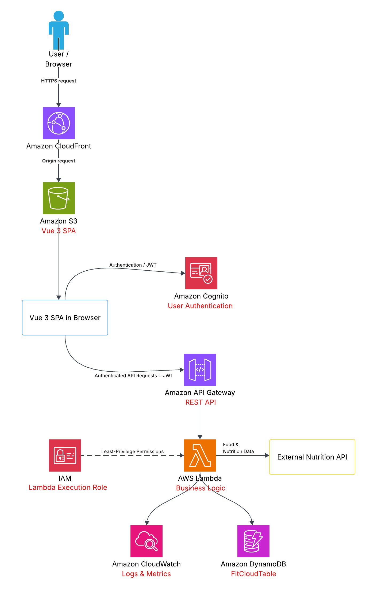

# RepVelta

RepVelta is a serverless fitness tracking and nutrition management web application built on AWS.

## Planned Features

- User registration and authentication
- Workout tracking
- Exercise history and progress tracking
- Daily food logging
- Nutrition analysis, including calories and protein intake
- Body measurement tracking for weight, body fat, and waist trends
- AI Fitness Coach with authenticated workout and nutrition tools

## Architecture

RepVelta uses a serverless AWS architecture with services including Amazon S3, CloudFront, Cognito, API Gateway, AWS Lambda, DynamoDB, CloudWatch, and IAM.

## AI Coach

The AI Coach implementation is in `backend/ai-coach`. It uses the OpenAI Agents SDK inside AWS Lambda and exposes four read-only tools for profile goals, recent workouts, recent nutrition, and seven-day progress. A fifth tool can prepare an account-goal update, but it has no side effects: the user must review and approve the proposal in the app before it is saved. Helpful/not-helpful ratings and optional feedback notes are included in later turns so the Agent can revise its advice. Weekly plans and goal changes remain human-controlled.

Required Lambda environment variables:

- `FITNESS_API_BASE_URL`
- `OPENAI_API_KEY_SECRET_ARN`
- `OPENAI_MODEL`
- `ALLOWED_ORIGIN`

After deploying the Lambda behind a Cognito-protected API Gateway `POST /coach` route, copy the endpoint into `frontend/.env` as `VITE_AI_COACH_API_URL`.

### Build the Lambda package

```powershell
cd backend/ai-coach
npm install
npm run build
Compress-Archive -LiteralPath dist/index.cjs -DestinationPath dist/repvelta-ai-coach.zip -Force
```

Create a Node.js Lambda function and upload `dist/repvelta-ai-coach.zip` with these settings:

- Runtime: Node.js 20 or later
- Handler: `index.handler`
- Timeout: 30 seconds
- Memory: 512 MB

The Lambda execution role needs `secretsmanager:GetSecretValue` permission for only the configured OpenAI secret. The API Gateway route must use the existing Cognito JWT authorizer so the Lambda can safely forward the authenticated user's token to the workout and nutrition APIs.

## Cloud weekly plans

The `backend/plans` Lambda stores AI-generated weekly plans for each authenticated user. Create a DynamoDB table named `RepVeltaPlans` with:

- Partition key: `userId` (String)
- Sort key: `planId` (String)
- Billing mode: on-demand

Build the deployment package:

```powershell
cd backend/plans
npm install
npm run build
Compress-Archive -LiteralPath dist/index.cjs -DestinationPath dist/repvelta-plans.zip -Force
```

Create a Node.js 20 or later Lambda with handler `index.handler`, then configure:

- Environment variable `PLANS_TABLE_NAME=RepVeltaPlans`
- Environment variable `ALLOWED_ORIGIN` with the frontend origin
- DynamoDB permissions for `Query`, `PutItem`, `UpdateItem`, and `DeleteItem` on only the `RepVeltaPlans` table

Add a Cognito-protected API Gateway `ANY /plans` route using this Lambda integration. The Lambda accepts `GET`, `POST`, `PATCH`, and `DELETE`; include those methods in the API's CORS configuration. Set the resulting endpoint in `frontend/.env`:

```text
VITE_PLANS_API_URL=https://your-api-id.execute-api.ap-southeast-2.amazonaws.com/plans
```

Until that variable is configured, the frontend continues using per-user browser storage so local development remains functional.

## Delete workout Lambda

`backend/delete-workout` contains the authenticated handler used by `DELETE /workouts?workoutId=...`.
The Lambda execution role needs `dynamodb:DeleteItem` permission for the `FitCloudWorkouts` table only. Configure `WORKOUTS_TABLE` if the deployed table uses a different name, attach the existing Cognito JWT authorizer to the API Gateway route, and use `index.handler` as the Lambda handler.

## Update nutrition Lambda

`backend/update-nutrition` contains the authenticated handler for `PUT /nutrition`.
Deploy it as a Node.js 20 or later Lambda using handler `index.handler`. Configure
`NUTRITION_TABLE` with the nutrition table name and grant the execution role
`dynamodb:UpdateItem` on only that table. The `PUT /nutrition` API Gateway route
must use the existing Cognito JWT authorizer.

## Cloud profile preferences

`backend/profiles` contains the authenticated `GET /profile`, `PUT /profile`,
and `DELETE /profile` handler used to sync display names, weekly workout goals,
and daily calorie goals across devices. The delete operation removes the user's
profile, workout, nutrition, and weekly-plan records before Cognito account
deletion. Create an
on-demand DynamoDB table named `RepVeltaProfiles` with
`userId` (String) as its partition key, then deploy the handler as a Node.js 20
or later Lambda using `index.handler`.

Configure these environment variables:

- `PROFILES_TABLE=RepVeltaProfiles`
- `WORKOUTS_TABLE=FitCloudWorkouts`
- `NUTRITION_TABLE=FitCloudNutrition`
- `PLANS_TABLE_NAME=RepVeltaPlans`
- `BODY_METRICS_TABLE=RepVeltaBodyMetrics`
- `ALLOWED_ORIGIN=https://main.d4qy0pgoybda9.amplifyapp.com`

Grant the Lambda role `dynamodb:GetItem`, `dynamodb:UpdateItem`, and
`dynamodb:DeleteItem` on the profiles table. For account cleanup, also grant
`dynamodb:Query` and `dynamodb:BatchWriteItem` on `FitCloudWorkouts`,
`FitCloudNutrition`, `RepVeltaPlans`, and `RepVeltaBodyMetrics`. Attach it to Cognito-protected API
Gateway `GET /profile`, `PUT /profile`, and `DELETE /profile` routes. The frontend
keeps a local fallback when the cloud profile API is unavailable. If another API endpoint is used, set
`VITE_PROFILE_API_URL` in the frontend environment.

## Body measurements

`backend/body-metrics` contains the authenticated handler for body measurement
records and weight goals. Create an on-demand DynamoDB table named `RepVeltaBodyMetrics` with
`userId` (String) as the partition key and `metricId` (String) as the sort key.
Deploy the handler as a Node.js 20 or later Lambda using `index.handler` and configure:

- `BODY_METRICS_TABLE=RepVeltaBodyMetrics`
- `ALLOWED_ORIGIN` with the frontend origin

Grant the Lambda role `dynamodb:Query`, `dynamodb:PutItem`, `dynamodb:UpdateItem`,
and `dynamodb:DeleteItem` on only the body metrics table. Attach it to a
Cognito-protected API Gateway `ANY /body-metrics` route and set the endpoint as
`VITE_BODY_METRICS_API_URL`. Until this variable is configured, the frontend uses
per-user browser storage. The frontend uses `PATCH /body-metrics` to save a target
weight in the same table under the reserved `GOAL` sort key, and calculates 7-day,
30-day, and goal-progress summaries from the authenticated user's records.


