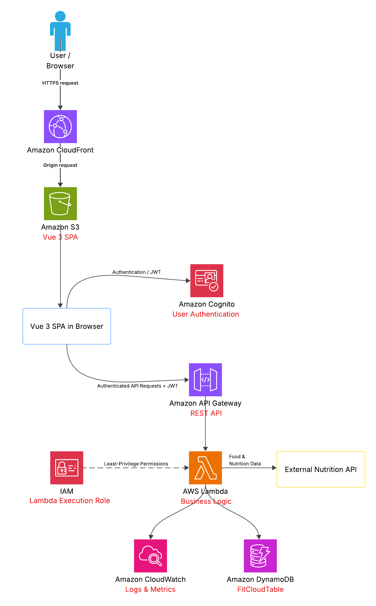

# RepVelta

RepVelta is a serverless fitness tracking and nutrition management web application built on AWS.

## Planned Features

- User registration and authentication
- Workout tracking
- Exercise history and progress tracking
- Daily food logging
- Nutrition analysis, including calories and protein intake
- AI Fitness Coach with authenticated workout and nutrition tools

## Architecture

RepVelta uses a serverless AWS architecture with services including Amazon S3, CloudFront, Cognito, API Gateway, AWS Lambda, DynamoDB, CloudWatch, and IAM.

## AI Coach

The first AI Coach implementation is in `backend/ai-coach`. It uses the OpenAI Agents SDK inside AWS Lambda and exposes three read-only tools for recent workouts, recent nutrition, and seven-day progress.

Required Lambda environment variables:

- `FITNESS_API_BASE_URL`
- `OPENAI_API_KEY_SECRET_ARN`
- `OPENAI_MODEL`
- `ALLOWED_ORIGIN`

After deploying the Lambda behind a Cognito-protected API Gateway `POST /coach` route, copy the endpoint into `frontend/.env` as `VITE_AI_COACH_API_URL`.

### Build the Lambda package

```powershell
cd backend/ai-coach
npm install
npm run build
Compress-Archive -LiteralPath dist/index.cjs -DestinationPath dist/repvelta-ai-coach.zip -Force
```

Create a Node.js Lambda function and upload `dist/repvelta-ai-coach.zip` with these settings:

- Runtime: Node.js 20 or later
- Handler: `index.handler`
- Timeout: 30 seconds
- Memory: 512 MB

The Lambda execution role needs `secretsmanager:GetSecretValue` permission for only the configured OpenAI secret. The API Gateway route must use the existing Cognito JWT authorizer so the Lambda can safely forward the authenticated user's token to the workout and nutrition APIs.

## Cloud weekly plans

The `backend/plans` Lambda stores AI-generated weekly plans for each authenticated user. Create a DynamoDB table named `RepVeltaPlans` with:

- Partition key: `userId` (String)
- Sort key: `planId` (String)
- Billing mode: on-demand

Build the deployment package:

```powershell
cd backend/plans
npm install
npm run build
Compress-Archive -LiteralPath dist/index.cjs -DestinationPath dist/repvelta-plans.zip -Force
```

Create a Node.js 20 or later Lambda with handler `index.handler`, then configure:

- Environment variable `PLANS_TABLE_NAME=RepVeltaPlans`
- Environment variable `ALLOWED_ORIGIN` with the frontend origin
- DynamoDB permissions for `Query`, `PutItem`, `UpdateItem`, and `DeleteItem` on only the `RepVeltaPlans` table

Add a Cognito-protected API Gateway `ANY /plans` route using this Lambda integration. The Lambda accepts `GET`, `POST`, `PATCH`, and `DELETE`; include those methods in the API's CORS configuration. Set the resulting endpoint in `frontend/.env`:

```text
VITE_PLANS_API_URL=https://your-api-id.execute-api.ap-southeast-2.amazonaws.com/plans
```

Until that variable is configured, the frontend continues using per-user browser storage so local development remains functional.

## Delete workout Lambda

`backend/delete-workout` contains the authenticated handler used by `DELETE /workouts?workoutId=...`.
The Lambda execution role needs `dynamodb:DeleteItem` permission for the `FitCloudWorkouts` table only. Configure `WORKOUTS_TABLE` if the deployed table uses a different name, attach the existing Cognito JWT authorizer to the API Gateway route, and use `index.handler` as the Lambda handler.


